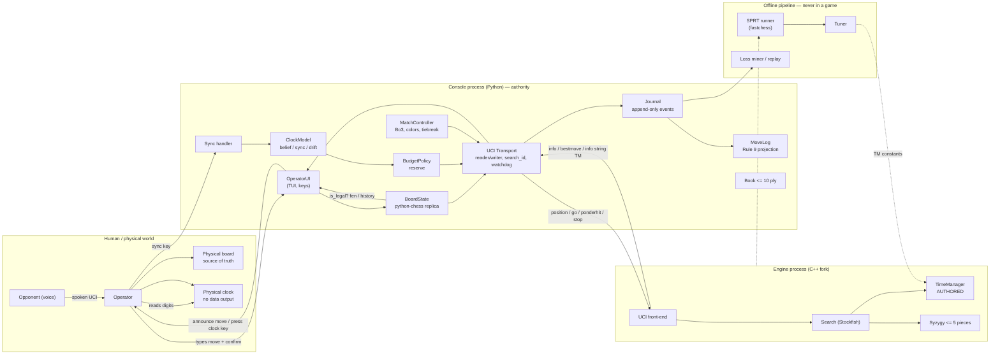
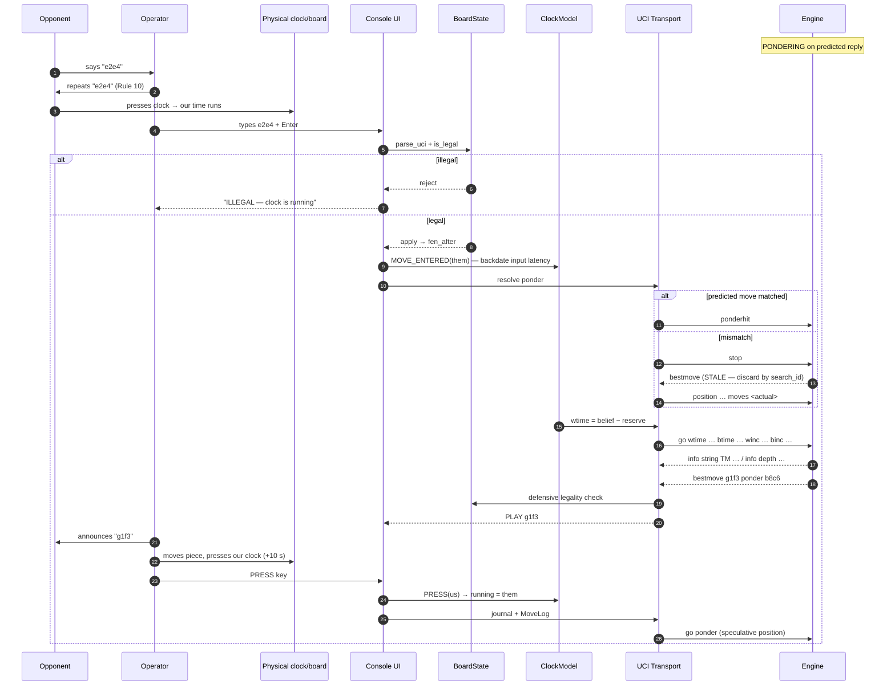

# Architecture Research

**Domain:** Competition chess engine — Stockfish fork + operator console + offline AI pipeline
**Researched:** 2026-10-26
**Confidence:** HIGH — Stockfish `master` sources (`timeman.{h,cpp}`, `search.cpp`, `uci.cpp`, `thread.cpp`, `engine.cpp`) and the April 2006 UCI spec were read directly. Console/pipeline recommendations are design judgments derived from those facts.

---

## Decision Summary (read this first)

| # | Question | Decision |
|---|----------|----------|
| 1 | Console process vs in-process engine | **Separate OS process, UCI over stdin/stdout pipes.** The console spawns and owns the engine child. No FFI, ever. |
| 2 | Who owns the clock | **The console, exclusively.** The engine's `TimeManagement` owns *allocation within a ceiling*, never the clock. Two layers, one direction of authority. |
| 3 | What the engine receives | A **reserve-discounted clock** (`wtime = belief − reserve`), the opponent's clock, and the raw increment. **Never `movetime`** (bypasses the authored TM → Rule 2 exposure), **never `movestogo`** (switches Stockfish to the wrong TM branch). |
| 4 | Where the TM lives | **Inside the engine**, replacing `src/timeman.cpp`. This is the Rule 2 authored component. It must be instrumented with an `info string TM …` trace line so the console and the log can see its decision. |
| 5 | Ponder strategy | Native `go ponder` on the speculated position; `ponderhit` on match; `stop` + **search-id discard** on miss. Stockfish's elapsed clock already counts ponder time, which yields a free instant move on a long ponder hit. |
| 6 | Game state model | **Event-sourced journal.** Board, clock, and the Rule 9 log are all projections. Crash recovery and loss mining fall out for free. |
| 7 | Build order | **Freeze the contract on day 0**, then three parallel tracks, then four serial integration gates. The console is the critical path. |

**The one-sentence architecture:** a Python console is the sole authority over time, board state, and the log; it drives a C++ Stockfish fork through a narrow, instrumented UCI contract; the engine decides *how* to spend a budget it is told, never *what* the budget is.

---

## Standard Architecture

### System Overview



### Authority boundaries (the ASCII version)

```
 ┌────────────────────────────────┐
 │ HUMAN / PHYSICAL WORLD         │
 │ opponent voice                 │
 │ physical board = source truth  │
 │ physical clock = source truth  │
 │ operator (eyes + hands)        │
 └───────────────┬────────────────┘
                 │  types UCI move · presses SYNC · presses clock key
                 ▼
 ┌────────────────────────────────┐   stdin    ┌────────────────────────────────┐
 │ CONSOLE PROCESS (Python)       │───────────▶│ ENGINE PROCESS (C++ fork)      │
 │ OperatorUI                     │            │ UCI front-end                  │
 │ BoardState (replica)           │◀───────────│ Search                         │
 │ ClockModel (belief)            │   stdout   │ TimeManager   <== AUTHORED     │
 │ BudgetPolicy (reserve)         │            │ Syzygy (<= 5 pieces)           │
 │ UCI Transport (search_id)      │            └────────────────────────────────┘
 │ Journal ──▶ MoveLog (Rule 9)   │
 │ MatchController (Bo3)          │            ┌────────────────────────────────┐
 └───────────────┬────────────────┘            │ OFFLINE PIPELINE               │
                 │  journal file               │ never runs during a game       │
                 └────────────────────────────▶│ SPRT / tuning / loss mining    │
                                               └────────────────────────────────┘

 Authority flows one way (console ──▶ engine). Observation flows the other way
 (engine ──▶ console). The engine never learns wall-clock time. The console never
 reads engine internals directly — only the instrumented UCI stream.
```

### Component Responsibilities

| Component | Owns | Must NOT own | Implementation |
|-----------|------|--------------|----------------|
| **TimeManager** (engine) | Mapping `(time, inc, ply, options)` → `optimum`, `maximum` | The real clock, input latency, tiebreak standing | `src/timeman.{h,cpp}` rewritten; `init()` sees only what `go` sent |
| **UCI front-end** (engine) | Command parsing, `info` emission | Game state, logging | Largely stock; add option registration + TM trace |
| **UCI Transport** (console) | Pipe lifecycle, line framing, `info` cache, search ids, watchdog | Move legality, time policy | Custom thin client (~250 lines). Do **not** delegate to `python-chess`'s `play()` |
| **BoardState** (console) | Replicated position, move list, legality, game-over detection | Being the source of truth (the physical board is) | `chess.Board`, `parse_uci`, `is_legal`, `outcome()` |
| **ClockModel** (console) | Belief of both clocks, sync snapping, drift/latency EMAs | Allocating search time per move | Monotonic clock + event handlers |
| **BudgetPolicy** (console) | `reserve` and the `wtime` projection | Choosing `optimum`/`maximum` | Pure function of ClockModel state |
| **MatchController** (console) | Game/round state, colors, cumulative remaining time, Armageddon | Per-move play | State machine fed by journal events |
| **Journal** (console) | Every operator/engine event, append-only | Deciding anything | Newline JSON, fsync per move |
| **MoveLog** (console) | Rule 9 projection (all 8 fields) | Being the only copy of state | Regenerated from journal |
| **Book** (console) | First ≤10 plies | Engine-side book | Polyglot reader, console decides before `go` |
| **MatchController / pipeline** | SPRT, tuning, loss mining | Running during a game | Separate process tree, separate binary copy |

> **Book vs tablebase placement (deliberate asymmetry).** The book lives in the **console** because Rule 3 caps it at 10 half-moves and it must be visible in the log as a non-engine decision. The tablebase lives in the **engine** via `SyzygyPath` because Stockfish's probing is already correct and fast; Rule 4 compliance is enforced by pointing `SyzygyPath` at a directory that contains **only** ≤5-piece files and by the console refusing to start otherwise.

---

## 1. The Process Boundary

**Recommendation: separate process. The console spawns the engine as a child and speaks UCI over two pipes.**

This is not a close call. The three requirements in the question each independently favour it:

| Console requirement | Separate process | In-process |
|---|---|---|
| **(a) Supply the opponent's moves** | `position startpos moves …` — the console's move list is the input. Trivial. | Console must reach into `Position::do_move` / `States` internals; tight coupling to a pinned commit. |
| **(b) Know the real remaining clock, which the engine does not** | Console computes `wtime` and sends it. The engine *cannot* overspend because it never sees the raw clock. | The clock becomes a shared mutable field. Any engine bug that reads it wrongly is unfixable from the console. |
| **(c) Capture `info` lines for the log** | The `info` stream is already serialised, rate-limited, and ordered. A reader thread parses it. | Needs thread-safe callbacks into Python; Stockfish's `on_update_full` is a C++ callback — FFI marshalling on a hot path. |

Additional decisive factors:

- **Crash isolation.** A segfault in the engine must not kill the clock, the journal, or the log. With a child process, the console restarts the engine and replays `position … moves …` in under a second. In-process, a crash is a lost game.
- **The console is the safety system.** It enforces the hard deadline with `stop`. That enforcement is meaningless if the thing being stopped shares an address space and can corrupt it.
- **Testability.** The same engine binary is the SPRT subject. The console can be developed against **stock Stockfish** on day 1 and never block on the fork.
- **Language fit.** The operator UI, journal, clock math, and log are 5× faster to write and iterate in Python. The engine must be C++.
- **Ponder is a protocol feature.** `go ponder` / `ponderhit` / `stop` is exactly the state machine we need, and it only exists at the UCI boundary.

**Costs, honestly:** ~0.1–1 ms per line of IPC (irrelevant at 15+10); a string protocol to parse and sanitise; a reader thread; the console cannot read `tm.optimum()` directly. That last cost is closed by the **TM trace line** (below), not by abandoning the boundary.

**The one thing that would justify in-process** is if the console needed per-node information. It does not — Rule 9 asks for depth, nodes, score, PV, and time, all of which appear in every `info` line.

### The console must NOT be a plain `python-chess` client

`chess.engine.SimpleEngine.play(..., ponder=True)` does implement pondering — it speculates `best.move + best.ponder`, sends `go ponder`, and sends `ponderhit` or `stop`. But its **clock adjustment assumes the engine owns the clock**:

```python
# python-chess master, chess/engine.py, _bestmove()
time_used = time.perf_counter() - self.start_time
ponder_limit.white_clock += (ponder_limit.white_inc or 0.0)
if self.pondering.turn == chess.WHITE:
    ponder_limit.white_clock -= time_used     # <-- our search time, debited again
```

That is a reasonable heuristic for an engine-vs-engine match and the wrong model for us: it debits *our own search time* from the *next* budget and ignores the real input delay, the return latency, and any physical-clock sync. Use `python-chess` for the **board** (`chess.Board`, legality, PGN, Polyglot) and write the **transport and ponder state machine ourselves**.

### Engine lifecycle

- One engine process per **match**, not per move. The transposition table must persist across moves.
- `ucinewgame` + `isready` between games.
- Restart only on crash, then: `uci` → configure → `position startpos moves <full history>` → resume.
- Capture the engine's **stderr** to a file. Debug output must never touch stdout.
- Spawn with a clean environment; no network syscalls needed (Rule 14 — verify by running the game with interfaces down, not by trusting the code).

---

## 2. The Clock Authority Model

### 2.1 Why two layers

The physical clock is authoritative and has **no digital output**. The engine is the only component fast enough to exploit time, but it is also the component least able to know the truth. Splitting responsibilities is the whole design:

| Layer | Lives in | Answers | Fed by |
|-------|----------|---------|--------|
| **ClockModel** | Console | "How much time do we actually have right now?" | Operator sync + monotonic time |
| **BudgetPolicy** | Console | "How much of it may the engine be told about?" | ClockModel + latency EMAs |
| **TimeManager** | Engine | "Given that budget, how should this move's search be bounded?" | `go wtime/btime/winc/binc` |
| **Watchdog** | Console | "Did the engine exceed the ceiling?" | Wall time + `stop` |

Putting the TM in the console would be simpler and would **fail Rule 2**, which requires a decisory component *of the engine*, functional during matches. Keeping the TM in the engine without the console's layer would **lose games on time**, because Stockfish assumes it is talking to a GUI that presses the clock within ~10 ms of receiving `bestmove` (its `Move Overhead` default is literally `10`).

### 2.2 ClockModel state

```python
@dataclass
class ClockModel:
    # per side, milliseconds
    remaining: dict[Color, int]          # belief snapshot at `since`
    increment: int = 10_000              # 15+10
    running: Color | None = None         # whose clock the operator last pressed
    since_ns: int = 0                    # monotonic timestamp of last transition

    # calibration
    drift_ema_ms: float = 0.0            # observed - predicted, EMA of sync residuals
    drift_sigma_ms: float = 0.0
    input_latency_ema_ms: float = 1200   # announcement -> move validated
    return_latency_ema_ms: float = 2000  # bestmove received -> clock physically pressed

    def belief(self, side, now_ns) -> int:
        if self.running == side:
            return self.remaining[side] - (now_ns - self.since_ns) // 1_000_000
        return self.remaining[side]
```

Invariants:

- **Monotonic time only.** `time.monotonic_ns()` / `CLOCK_MONOTONIC`. No `datetime.now()`. No network means no NTP, but suspend/resume and manual clock changes still bite wall-clock arithmetic.
- `belief()` is **computed**, never incrementally decremented by a UI timer tick. A blocked UI thread must not freeze the clock (see anti-pattern 6).
- All times in integer milliseconds. No floats in the authoritative path.
- The **increment is added on the press of the side that just moved**, matching physical clock behaviour: `remaining[mover] += increment` at the press event, not at the move event.

### 2.3 The event set

| Event | Trigger | State change |
|-------|---------|--------------|
| `PRESS(side)` | Operator key after physically pressing the clock | `remaining[side] += increment`; `snapshot` both sides; `running = other`; `since = now` |
| `MOVE_ENTERED(side, uci, t_typed)` | Operator submits the opponent's move | Backdate: `since -= input_latency`, i.e. debit `input_latency` from **our** clock immediately; then treat as `PRESS(opponent)` |
| `SYNC(side, observed_ms, t_read)` | Operator presses the sync key | `delta = observed − belief(side)`; snap `remaining[side] = observed`; engine-side `since = t_read`; update `drift_ema`, `drift_sigma` |
| `GAME_END(final_remaining)` | Operator syncs both clocks at the end | Records the **official** Rule 12 figure — do not use `belief()` |
| `RESYNC_BOARD(fen)` | Operator corrects the replica from the physical board | Board only; clock untouched |

### 2.4 Why `MOVE_ENTERED` backdates

The opponent presses their clock at `T_press`. The console only learns the move at `T_typed = T_press + L`, where `L` is the input delay (announcement → confirmation → physical move → typing). If the console starts our clock at `T_typed`, our belief is **`L` milliseconds too generous** — on every single move. Over 60 moves at 1.2 s each that is **72 seconds of phantom time**, i.e. a loss on time that looks impossible.

Fix: `since = T_typed − input_latency_ema`. The engine's budget immediately reflects that part of our clock is already gone. Calibrate `input_latency_ema` in two parts:

- **Measured automatically:** the typing window, from the operator's first keystroke to successful validation. Exact, and it dominates on slow move entry.
- **Seeded, then refined by sync residuals:** the announcement window (opponent speaks → operator starts typing), which the software cannot observe. The `SYNC` residuals in §2.3 reveal any systematic bias in `L`; feed them back into the EMA.

This is the single highest-value line of clock code in the project. Note the same `T_press` estimate should be used to credit the opponent's `+10 s` increment — but an error of `L` on *their* clock only perturbs the tiebreak heuristic, not our survival.

### 2.5 Budget derivation (the contract with the engine)

```
belief_us   = ClockModel.belief(us, now)                  # what we think we have
reserve     = return_latency_p95                          # bestmove -> clock pressed
            + max(0, -drift_ema) + 2 * drift_sigma        # if the real clock runs fast
            + IPC_SLACK                                   # ~100 ms
effective   = clamp(belief_us - reserve, MIN_THINK, belief_us - EMERGENCY_FLOOR)

send:  go wtime <effective> btime <belief(them)> winc 10000 binc 10000
```

| Constant | Suggested seed | Rationale |
|----------|----------------|-----------|
| `return_latency_p95` | 2000 ms | Operator reads move, announces it aloud, moves the piece, presses. Measured in rehearsal. |
| `EMERGENCY_FLOOR` | 250 ms | The console must always be able to `stop` and press. Never think in the last quarter second. |
| `MIN_THINK` | 50 ms | Below this, the engine's fixed overhead dominates; play instantly. |
| Engine `Move Overhead` option | **100 ms** | Covers IPC + OS only. **Do not** also set it to 2000 — the console already reserved that; double-counting costs real Elo. |
| Engine `Ponder` option | `true` | Stockfish adds +25 % to `optimum` when ponder is enabled (`timeman.cpp`); correct here because ponder time is genuinely free. |

**Never send `movestogo`.** Verified in `timeman.cpp`: `if (limits.movestogo == 0)` selects the *base + increment* branch; any non-zero value selects the *x moves in y seconds* branch (`optScale = min((0.88 + ply/116.4)/mtg, …)`). 15+10 is sudden death. Sending `movestogo` silently degrades the TM to a different algorithm.

**Never send `movetime` for the real move.** If the console sends `movetime` *instead of* clock fields, `limits.time[us]` stays `0`, and `TimeManagement::init` takes the early return `optimumTime = maximumTime = NoBound` — the authored TM is **not executed at all**. That is a direct Rule 2 exposure: the component you are defending to the banca would be dead during the games. (Sending both is merely redundant; dropping the clock fields is fatal to the authorship claim.)

**Send both clocks.** `use_time_management()` is `time[WHITE] || time[BLACK]`, and `timeman.cpp` derives `timeAdvantage = (time[us] − time[~us]) / (1 + time[us] + time[~us])` to spend less when behind on the clock. Send `btime = belief(them)`; a zero makes that heuristic blind.

### 2.6 The watchdog is not the policy

Two independent limits, deliberately:

| Limit | Enforced by | Value | Purpose |
|-------|-------------|-------|---------|
| Soft | `TimeManager` (`maximum`) | engine's own choice | Strong play |
| Hard | Console watchdog | `belief − EMERGENCY_FLOOR` | Never lose on time |

The watchdog fires `stop`, not `quit`. `stop` is guaranteed to produce a `bestmove` (UCI: "this command must always be sent if the engine stops searching, also in pondering mode"). The result is always a legal move from a completed iteration.

### 2.7 The TM trace line — closing the observability gap

Add one line at the top of every search, behind a `--tm-trace` flag (zero cost, one `sync_endl`):

```
info string TM ply=34 stm=w t=812340 inc=10000 optimum=4210 maximum=9830
                 reserve=487 bias=tiebreak:-0.15 mtg=0
```

Why this matters three times over:

1. **Logging.** Rule 9 does not ask for the budget, but post-game diagnosis does: "we lost because the TM gave 4.2 s to a critical move" is the finding that wins the next game.
2. **Rule 2 defence.** The arguição can be answered with a per-move table of *the TM's actual decision*, not a slide.
3. **Offline tuning.** The pipeline tunes `optimum`/`maximum` against real game traces, not synthetic assumptions.

It also lets the console sanity-check the TM on the fly: if `maximum > effective` or `optimum <= 0`, the TM has a units or clamping bug, and the console can flag it immediately instead of discovering it as a time loss. The console's hard watchdog remains independent of this line (§2.6) — the trace is for observation and logging, not enforcement.

### 2.8 Where the sync key sits in the UI

- `S` → sync the **side to move**; `Shift+S` → sync the opponent.
- The console prompts for `mm:ss`, echoes the parsed value, and shows `predicted / observed / delta`.
- If `|delta| > 5000 ms`, require a second confirmation keystroke. A mis-typed sync is worse than no sync.
- Every sync is a journal event with the residual. After the game, the residual series *is* the clock-drift report.
- **The sync key must work while the engine is thinking.** Both clocks keep running during search; the operator may read the clock at any moment.

---

## 3. The UCI Dialogue in Full

### 3.1 Match start

```
console → uci
engine  ← id name <fork> <commit>
engine  ← id author <team>
engine  ← option name Threads type spin default 1 min 1 max 1024
engine  ← option name Hash type spin default 16 min 1 max 33554432
engine  ← option name SyzygyPath type string default <empty>
engine  ← option name Move Overhead type spin default 10 min 0 max 5000
engine  ← option name Ponder type check default false
engine  ← option name TiebreakBias type spin default 0 min -100 max 100   ← TEAM OPTION
engine  ← option name MinThinkMs type spin default 50 min 0 max 5000      ← TEAM OPTION
engine  ← uciok

console → setoption name Threads value 15
console → setoption name Hash value 4096
console → setoption name SyzygyPath value /opt/tb/3-4-5
console → setoption name Move Overhead value 100
console → setoption name Ponder value true
console → isready
engine  ← readyok
```

`setoption` is only legal while the engine is **waiting** (UCI spec), so `Threads`/`Hash`/`SyzygyPath` are match-start only. `TiebreakBias` may be updated **between games** (and, carefully, between moves while idle) to reflect the match standing — this is how Rule 12's total-time tiebreak enters the TM.

### 3.2 A normal move

```
console → position startpos moves e2e4 e7e5 g1f3
console → go wtime 798000 btime 851000 winc 10000 binc 10000
engine  ← info string TM ply=5 stm=b t=798000 inc=10000 optimum=3900 maximum=9100 …
engine  ← info depth 18 seldepth 26 multipv 1 score cp -12 nodes 812345 nps 2100000 hashfull 4 tbhits 0 time 1400 pv b8c6 f1b5 …
engine  ← info depth 22 seldepth 31 multipv 1 score cp -8  nodes 1843200 nps 2110000 hashfull 9 tbhits 0 time 3100 pv g8f6 …
engine  ← bestmove b8c6 ponder g1f3
```

### 3.3 Ponder cycle — the part that must be exactly right

```
# Our search returned: bestmove g1f3 ponder b8c6
# Console speculates the opponent's reply and sends the SPECULATIVE position:

console → position startpos moves e2e4 e7e5 g1f3 b8c6     ← note b8c6 appended
console → go ponder wtime 795000 btime 848000 winc 10000 binc 10000
engine  ← info depth 24 … pv f1b5 …                      ← searching OUR reply to b8c6

# --- Case A: opponent actually plays b8c6 ---
console → ponderhit
engine  ← (stops almost immediately, returns the deep result)
engine  ← bestmove f1b5 ponder g8f6

# --- Case B: opponent plays d7d6 instead ---
console → stop
engine  ← bestmove f1b5 ponder g8f6         ← STALE: move for the wrong position
                                              console MUST discard this by search_id
console → position startpos moves e2e4 e7e5 g1f3 d7d6
console → go wtime 795000 btime 846000 winc 10000 binc 10000
```

Two facts from the UCI spec that drive this whole design:

> "**`ponder`** — start searching in pondering mode. … This means that **the last move sent in the position string is the ponder move.**"

> "**`bestmove`** — … this command must always be sent if the engine stops searching, also in pondering mode if there is a `stop` command, **so for every `go` command a `bestmove` command is needed!**"

### 3.4 Game end

```
console → stop            (defensive; only if searching)
console → position startpos moves …   (final position for the record)
console → quit
```

The **official** remaining time for Rule 12 comes from the operator reading the physical clock, entered via `SYNC`, not from `ClockModel.belief()`.

---

## 4. Data Flow of One Spoken Move

Boundaries crossed, in order, with the state change at each:

| # | Event | Boundary | State change | Failure if skipped |
|---|-------|----------|--------------|--------------------|
| 0 | Engine is pondering on the predicted reply | console→engine | engine `THINKING(PONDER)` | Lose free time |
| 1 | Opponent says "e2e4" aloud | acoustic → human | none (console idle) | — |
| 2 | Opponent repeats for confirmation (Rule 10) | human → human | none | Wrong move enters the system |
| 3 | Opponent presses their clock; **our clock starts** | human → physical | console **does not know** — this is the input-delay gap | Belief runs generous (see §2.4) |
| 4 | Operator types `e2e4` + Enter | human → console (stdin) | UI buffer only | — |
| 5 | Parse + `board.is_legal()` | inside console | **none on failure** | Corrupt board |
| 6 | Apply to replica | inside console | `board.fen`, `move_stack`, `turn` flip | Desync |
| 7 | Resolve ponder | console→engine | `PARSE` → `PONDER_HIT` or `PONDER_MISS` | Stale bestmove played |
| 8 | ClockModel `MOVE_ENTERED` | inside console | backdate `input_latency`; `running = us`; `their remaining −= elapsed`; `their remaining += inc` | Loss on time |
| 9 | `position` + `go` | console→engine | engine `THINKING`, `search_id += 1` | — |
| 10 | `info` stream absorbed | engine→console | `last_info[search_id]` (depth, score, nodes, pv, time) | Rule 9 fields missing |
| 11 | `bestmove` received | engine→console | `bestmove`, `ponder`; watchdog disarmed | — |
| 12 | Validate bestmove against replica | inside console | on failure → fallback move + `FAULT` event | Illegal move announced |
| 13 | Display `PLAY g1f3` to operator | console→human | UI state | Operator announces wrong move |
| 14 | Operator announces, moves piece, presses our clock | human → physical | console **does not know** | Belief runs generous |
| 15 | Operator hits `PRESS` key | human → console | `remaining[us] −= elapsed`; `+= inc`; `running = them` | Loss on time |
| 16 | Journal + MoveLog append | console → disk | Rule 9 line durable | Compliance failure |
| 17 | `go ponder` on the new speculation | console→engine | engine `PONDER` | Lose free time |



**The direction of truth is one-way at every boundary:**

```
physical board ──▶ operator ──▶ replica ──▶ engine position
physical clock ──▶ operator ──▶ ClockModel ──▶ wtime
engine ──▶ info/bestmove ──▶ journal ──▶ Rule 9 log
```

Nothing flows backwards. The engine never corrects the board; the console never corrects the physical board; the log never corrects the journal.

---

## 5. Ponder and Input Delay

### 5.1 What Stockfish actually does while pondering (verified)

Read from `master`:

- `uci.cpp` sets `limits.startTime = now()` when parsing `go`.
- `timeman.cpp` does `startTime = limits.startTime`, so **elapsed time includes all ponder time**.
- `search.cpp::check_time()` returns early while `ponder` is true: the engine will *not* stop on its own, even on mate.
- In the iterative-deepening loop, when the best move is ready but we are pondering, the engine sets `stopOnPonderhit = true` instead of stopping.
- On `ponderhit`, `Engine::set_ponderhit(false)` clears `ponder`; the next `check_time()` sees `elapsed > maximum() || stopOnPonderhit` and stops.

**Consequence — do not "fix" this.** Because elapsed already exceeds `maximum` after a long ponder, a ponder hit returns the deep result **almost instantly**, at zero cost to our clock. That is precisely the behaviour we want. Do not patch `startTime` on `ponderhit`; doing so would make the engine keep searching on *our* clock after it already had a free, deep answer.

| Ponder duration when the move arrives | Engine behaviour on `ponderhit` | Console action |
|---|---|---|
| > `maximum` | stops at the next `check_time` (ms) | none — free move |
| between `optimum` and `maximum` | stops at next iteration boundary | none |
| < `optimum` | continues searching the remainder | none |

### 5.2 The ponder state machine

```
  IDLE ──go──▶ THINKING ──bestmove──▶ IDLE
   │
   └──go ponder──▶ PONDERING ──ponderhit──▶ THINKING
                       │
                       └──stop──▶ DISCARDING ──stale bestmove──▶ IDLE
```

| State | Event | Next | Action |
|-------|-------|------|--------|
| `IDLE` | `go …` | `THINKING` | send; arm watchdog; `search_id += 1` |
| `IDLE` | `go ponder …` | `PONDERING` | send; **no** watchdog (their clock, not ours) |
| `PONDERING` | speculated move matched | `THINKING` | send `ponderhit`; arm watchdog |
| `PONDERING` | mismatch | `DISCARDING` | send `stop`; set `discarding = True` |
| `PONDERING` | `SYNC` changed belief | `PONDERING` | `stop`, drain, re-`go ponder` with corrected `wtime` |
| `THINKING` | `bestmove` (matching id) | `IDLE` | validate, log, display |
| `DISCARDING` | `bestmove` (stale id) | `IDLE` | **drop**; then issue the real `go …` |
| any | engine EOF / watchdog kill | `IDLE` | restart, replay `position`, re-`go` |

Hard invariant: **exactly one `go` is outstanding at any time, and no new `go` may be sent until the matching `bestmove` arrives.** UCI has no request ids, so serialisation is the only correct discipline. Enforce it in the transport with an `outstanding_search_id: int | None` and an assertion.

### 5.3 Where speculation is discarded

Three distinct places, each with a different job:

| Location | What it discards | Trigger |
|----------|------------------|---------|
| `BudgetPolicy` | The pondered **clock projection** | Opponent's actual move differs from speculation and our belief changed |
| `UciTransport._on_bestmove()` | The stale **move** | `search_id != current` **or** `discarding == True` |
| `EngineSession` | The stale **ponder target** | New `bestmove.ponder` replaces `speculated_move` |

The dangerous case is Case B in §3.3: the engine owes a `bestmove` for the ponder `go`, and it will arrive *after* the `stop`, while the console is already preparing the real search. A naive handler sees `bestmove f1b5` and plays it — for a position that does not exist. The `search_id` + `discarding` flag is the only defence. **This is the single most likely game-losing bug in the console.** Write the test first.

### 5.4 Input delay: what is actually recoverable

The delay has four components, and only two are recoverable:

| Component | Typical | Recoverable? | Mechanism |
|-----------|---------|--------------|-----------|
| Opponent announces → operator hears | 0.3–0.6 s | No | Physics. Must be reserved. |
| Operator types the move | 0.8–2.0 s | **Partly** | Measured and backdated (§2.4); typing can start on the first syllable |
| Move validated → `go` sent | ~5 ms | Yes | Direct pipe write |
| `bestmove` → clock physically pressed | 1.5–3.0 s | No | Reserved via `return_latency_p95` (§2.5) |

Pondering converts the *typing* delay from "thinking time lost" into "thinking time already done". On a ponder hit, the move is available the instant validation finishes, so the only lost time is the typing window (backdated) — the engine does not need to start thinking at all.

On a ponder miss, the console pays `stop` + round-trip + a fresh search. The TT survives, so reaching the previous depth is typically a few hundred milliseconds. This is the correct trade: speculating on the single most likely reply is exactly what `bestmove … ponder …` gives you for free.

### 5.5 A sync during the opponent's turn

If the operator syncs while the engine is pondering, the pondered budget is stale. Handle it:

1. `stop` the ponder, drain the stale `bestmove` (search_id discard).
2. Recompute `effective` from the new belief.
3. Re-send `go ponder` on the **same** speculative position with the corrected `wtime`.

Journal it as `PONDER_REBASED`. This is cheap and it is the right moment — our clock is not running, so the only cost is the search restart, which the TT absorbs.

### 5.6 Explicitly out of scope for 1–2 weeks

- **A second engine process predicting the opponent's move.** It would help on ponder misses, but it halves the CPU available to the real search and doubles the transport state machines. Defer.
- **Multi-PV pre-computation of our replies to their top-3 moves.** Interesting, and a legitimate future differentiator, but Stockfish's native ponder already captures most of the value for a fraction of the complexity.
- **Dynamic speculation on the opponent's *likely* move from a shallow search.** Same objection.

---

## 6. Recommended Project Structure

```
ChessChallendIII/
├── engine/                          # Stockfish fork (upstream layout preserved)
│   ├── src/
│   │   ├── timeman.h                # AUTHORED — replace, do not patch
│   │   ├── timeman.cpp              # AUTHORED — the Rule 2 component
│   │   ├── search.cpp               # minimal touch: TM trace call
│   │   ├── engine.cpp               # register TiebreakBias / MinThinkMs
│   │   └── uci.cpp                  # unchanged
│   ├── UPSTREAM.md                  # pinned commit/version (Rule 1)
│   └── Makefile
│
├── console/
│   ├── src/console/
│   │   ├── main.py                  # wiring only
│   │   ├── ui/tui.py                # keys: move, confirm, PRESS, SYNC, STOP, RESYNC
│   │   ├── game/board.py            # python-chess replica + legality + outcomes
│   │   ├── game/journal.py          # event sourcing, fsync, replay
│   │   ├── game/match.py            # Bo3, colors, cumulative time, Armageddon
│   │   ├── clock/model.py           # ClockModel (belief, sync, drift)
│   │   ├── clock/policy.py          # reserve + budget projection
│   │   ├── transport/uci.py         # subprocess, reader/writer threads, search_id
│   │   ├── transport/parser.py      # info / bestmove / info string TM
│   │   ├── engine/session.py        # IDLE/PONDER/THINKING/DISCARDING FSM
│   │   ├── book/polyglot.py         # <=10 ply, console-side
│   │   ├── log/movelog.py           # Rule 9 projection
│   │   └── compliance/checks.py     # TB file sizes, no-network, license headers
│   └── tests/
│       ├── fixtures/mock_engine.py  # scriptable: delays, crashes, illegal moves
│       ├── test_clock.py
│       ├── test_ponder_discard.py   # the game-losing-bug test
│       ├── test_transport.py
│       └── test_journal_replay.py
│
├── pipeline/                        # never imported by console
│   ├── sprtt/{sprt.py, match.py, books/}
│   ├── tune/{spsa.py, trace_fit.py}
│   ├── mine/losses.py
│   └── tools/replay.py              # journal -> PGN + legality audit
│
└── docs/
    ├── PROTOCOL.md                  # FROZEN day 0: the UCI contract
    ├── LOGBOOK.md                   # FROZEN day 0: Rule 9 schema
    ├── TIMEMANAGER.md               # Rule 2 defence document
    └── COMPLIANCE.md                # Rules 1, 3, 4, 9, 14 evidence
```

**Rationale**

- `engine/` keeps upstream layout so upstream patches and `git diff` against the declared base commit stay legible — that diff *is* the Rule 1/Rule 2 evidence.
- `console/` is layered by **rate of change**: `transport` changes rarely once frozen, `ui` changes daily. Tests are colocated with the seam they protect.
- `pipeline/` is a sibling, never a dependency. If the console ever imports `pipeline`, the offline/in-game boundary has been violated.
- `docs/PROTOCOL.md` and `docs/LOGBOOK.md` are frozen artifacts, not living docs. Both are inputs to all three workstreams on day 0.

---

## 7. Architectural Patterns to Follow

### Pattern 1: Event sourcing for the whole game

**What:** Every operator action and engine event appends an immutable record to a journal. The board, the clock belief, the match standing, and the Rule 9 log are all *projections* recomputed from the journal.
**When:** Always, from the first line of console code. The journal is ~150 lines and pays for itself the first time the console crashes mid-game.
**Trade-offs:** Slightly more ceremony per action; a replay path to maintain. In exchange: crash recovery, an audit trail the banca can inspect, log regeneration, and free input for loss mining.

```python
# journal.py — the entire mechanism
def append(event: dict) -> None:
    event["t_mono_ms"] = time.monotonic_ns() // 1_000_000
    line = json.dumps(event, separators=(",", ":")) + "\n"
    fd = os.open(journal_path, os.O_WRONLY | os.O_CREAT | os.O_APPEND, 0o644)
    os.write(fd, line.encode())
    os.fsync(fd)              # a game is ~120 events; fsync is free
    os.close(fd)
    self.events.append(event)
```

```python
# movelog.py — Rule 9 is a PROJECTION, never a parallel write path
def project_rule9(journal) -> str:
    for mv in journal.of_type("MOVE_LOGGED"):
        yield (
            f'{mv["move_no"]:>3} {mv["color"]} {mv["uci"]:<5} '
            f'd={mv["depth"]} n={mv["nodes"]} {mv["score"]} '
            f't={mv["time_ms"]}ms src={mv["source"]} '
            f'pv={" ".join(mv["pv"])}'
        )
```

**Why this matters here specifically:** Rule 9 says the log is delivered at the end of each game. A log written only at game end is one crash away from non-compliance. A projection over an fsynced journal cannot be lost.

### Pattern 2: Search-id tagging (defence against UCI's missing request ids)

**What:** Monotonic counter incremented on every `go`. Every `info`/`bestmove` received is attributed to the outstanding id. Any message whose id is not current is dropped.
**When:** Mandatory. This is the only mechanism that survives the ponder-miss race.

```python
async def send_go(self, args: str, *, ponder: bool) -> int:
    assert self.outstanding is None, "UCI: one go at a time"
    self.search_id += 1
    self.outstanding = self.search_id
    self.last_info.pop(self.search_id - 2, None)     # bound memory
    self.proc.stdin.write(f"position {self.pos}\ngo {'ponder ' if ponder else ''}{args}\n")
    await self.proc.stdin.drain()
    return self.search_id

def _on_bestmove(self, move, ponder):
    sid, self.outstanding = self.outstanding, None
    if sid is None or sid != self.search_id or self.discarding:
        self.discarding = False
        journal.append({"e": "STALE_BESTMOVE", "search_id": sid, "move": move})
        return                      # <-- the discard point
    ...
```

### Pattern 3: Instrumented TimeManager (`info string TM …`)

**What:** One structured line per search describing the TM's actual decision.
**When:** Always on in development and rehearsal; keep it on in the match (cost is one line).
**Trade-offs:** None meaningful. Breaks the "engine is a black box" abstraction deliberately — which is the point.

### Pattern 4: Fail-safe watchdog (stop, never quit)

**What:** A console-side timer armed at `go` and disarmed at `bestmove`, firing `stop` at `belief − EMERGENCY_FLOOR`. Never `quit`, never `kill` unless `stop` itself is unresponsive.
**When:** Every single search, including the first.
**Trade-offs:** A stray `stop` costs depth; a missing `stop` costs the game. Asymmetric — always prefer the stray.

### Pattern 5: Dual-target logging

**What:** Write the Rule 9 line to the per-game file **and** to the journal, with the journal as the source of truth. On any write error, continue the game and flag a loud UI banner.
**When:** Always. Disk-full and permission errors happen at the worst time.

### Pattern 6: Tablebase/book placement by ownership

**What:** Book in the console (a decision the engine should not make, because Rule 3 caps it and it must be attributable in the log); tablebase in the engine (Stockfish already probes correctly).
**Trade-offs:** The log must distinguish `src=book` (no depth/nodes/eval available) from `src=engine`. Define this in `LOGBOOK.md` on day 0: `src=book d=0 n=0 score=none pv=<move> t=0`.

---

## 8. Anti-Patterns to Avoid

### Anti-Pattern 1: Letting the engine own the real clock

**What people do:** Send `wtime` as the wall-clock remaining and trust Stockfish's `Move Overhead` default of 10 ms.
**Why it's wrong:** The engine assumes a GUI presses the clock within milliseconds. Our operator takes 2 seconds. At 60 moves that is 2 minutes of unmodelled time — a loss on time that looks like a bug in the engine.
**Do instead:** Console computes `belief − reserve`; engine `Move Overhead` stays at 100; console watchdog is the hard backstop.

### Anti-Pattern 2: `go movetime` for the real move

**What people do:** "The console knows the budget, so just tell it `movetime`."
**Why it's wrong:** `movetime` leaves `limits.time[us] == 0`, so `TimeManagement::init` returns `optimum = maximum = NoBound`. The authored TM never runs. During the arguição you would be defending a component that was dead in every game — a direct Rule 2 failure.
**Do instead:** `go wtime/btime/winc/binc`. If you must bound hard, the console watchdog does it out-of-band with `stop`.

### Anti-Pattern 3: Playing the ponder `bestmove`

**What people do:** A single `bestmove` handler with no search ids.
**Why it's wrong:** After a ponder miss, the engine still owes — and will send — a `bestmove` for the speculative position. The console plays a move for a board that does not exist. This bug appears only against a real opponent (mocks are usually too well-behaved) and loses a game the first time it fires.
**Do instead:** Search ids + explicit `discarding` flag + `test_ponder_discard.py` written before the handler.

### Anti-Pattern 4: Deriving the clock from UI ticks

**What people do:** `remaining -= 100` in a `while True: sleep(0.1)` loop.
**Why it's wrong:** The loop drifts, blocks during search, and freezes when the engine floods `info`. A 5-minute game accumulates seconds of error.
**Do instead:** Compute from `monotonic_ns()` deltas against a snapshot. The UI *displays*; it never *owns*.

### Anti-Pattern 5: Rebuilding the board from the engine's position string

**What people do:** Trust the move list they last sent to the engine as the game record.
**Why it's wrong:** The engine is not the source of truth (Rule 5: the physical board is). If a typo lands in the engine's position, the console and the engine agree on a position that never existed.
**Do instead:** `BoardState` is authoritative within the software; `RESYNC_BOARD(fen)` can correct it from the physical board at any time; the engine is always re-fed the corrected `position`.

### Anti-Pattern 6: `setoption` mid-search

**What people do:** Update `TiebreakBias` or `Move Overhead` whenever the match state changes.
**Why it's wrong:** UCI: `setoption` is "only sent when the engine is waiting". Sending it during search is undefined behaviour in many engines and races with `go` parsing in ours.
**Do instead:** Queue option changes; apply them at the next `IDLE` transition, before the next `position`.

### Anti-Pattern 7: A blocking console

**What people do:** `subprocess.communicate()` or a synchronous read of `bestmove`, with the UI blocked behind it.
**Why it's wrong:** The operator cannot press `STOP` or `SYNC` while the engine is thinking — exactly when both are most needed.
**Do instead:** Reader thread pushes parsed events to a queue; the UI loop polls the queue and the keyboard; the clock is computed, never ticked.

### Anti-Pattern 8: Pausing the clock on rejection

**What people do:** When an illegal move is entered, freeze the console clock while the operator sorts it out.
**Why it's wrong:** The physical clock is still running. The console's belief diverges by exactly the argument duration, and it diverges in the *optimistic* direction.
**Do instead:** Reject without touching the clock; show `CLOCK RUNNING — 07:12 believed`; require a `SYNC` after the dispute resolves.

---

## 9. Failure Modes at the Seams

### 9.1 Summary

| Failure | Detected by | Response | Invariant preserved | Blast radius |
|---------|-------------|----------|---------------------|--------------|
| Operator typo (unparseable) | `parse_uci` raises | Reject, keep clock running, redisplay legal moves | Board unchanged | None |
| Operator typo (legal but wrong move) | Human confirmation (Rule 10) only | `UNDO` + `RESYNC_BOARD`; re-feed engine | Journal records both | One move |
| Illegal move announced by opponent | `is_legal` false | Reject; announce per Rule 10; clock keeps running | Board unchanged | None |
| Engine returns illegal move | Defensive `is_legal` on `bestmove` | Fallback: last PV head → book → first legal; journal `FAULT` | Game continues | One move's quality |
| Engine crash (exit/EOF) | Reader thread EOF | Restart, `uci` + options, `position startpos moves …`, re-`go` | Full history in console | ~1 s of clock |
| Engine hang (no `bestmove`) | Watchdog `stop` unresponsive > 300 ms | `kill -9`, restart, replay, fallback if budget exhausted | Full history in console | One move's quality |
| Clock desync discovered | `SYNC` residual | Snap belief, journal residual, update drift EMA | Belief re-anchored | Budget only |
| Unfinished ponder search on our turn | State machine sees `PONDERING` | `stop`, discard by search id, fresh `position` + `go` | No stale move played | One search restart |
| Ponder `bestmove` arrives late | search id mismatch | Drop, journal `STALE_BESTMOVE` | Correct move only | None |
| Log write fails | `OSError` | Dual-write to journal; UI banner; retry at game end | Journal retains truth | Compliance risk, mitigated |
| Board/engine desync | Human notices mismatch | `RESYNC_BOARD(fen)`; engine re-fed | Physical board wins | None (correct by definition) |
| Console crash | Process exit | Journal replay reconstructs everything | Audit trail | Recovery in seconds |

### 9.2 The four that actually decide games

**(a) The stale ponder `bestmove`.** Detailed in §5.3. Mitigation: search ids + `discarding` + a test fixture that scripts `stop` followed by a delayed `bestmove`.

**(b) Clock desync that is discovered too late.** The residual at sync is the *only* signal. Design consequences:
- Show the residual prominently on every sync; never silently accept a >5 s correction.
- Keep `drift_ema` and `drift_sigma`; they widen the reserve automatically when the operator is sloppy.
- If `belief < EMERGENCY_FLOOR` after a sync, enter **scramble mode**: `MinThinkMs` floor, no ponder, and immediate `stop` on `maximum`. Journal `SCRAMBLE_ENTERED`.
- If the sync reveals *more* time than believed, do **not** immediately spend it. The reserve recomputes; that is all.

**(c) Engine crash with the clock running.** The recovery is only cheap because the console owns the move list. Recovery budget:
```
1. EOF on stdout                       ~0 ms
2. kill + waitpid                      ~20 ms
3. spawn + uci handshake               ~150–400 ms  (NNUE load dominates)
4. setoption Threads/Hash/SyzygyPath   ~50 ms
5. position startpos moves <history>   ~5 ms
6. go wtime <belief − reserve>         ~1 ms
```
Total ~0.2–0.5 s. If `belief − reserve < 1500 ms`, skip the restart and play the fallback move immediately. Note that a *ponder-time* crash is free — not our clock.

**(d) An illegal move slipping past validation.** The engine's `bestmove` is validated against `BoardState` before display, and again by `BoardState.push()` which asserts legality. Two independent checks, because a corrupt `position` line sent to the engine can otherwise produce a plausible-looking move for the wrong board.

### 9.3 Deliberately not handled

- **Two clocks running simultaneously.** Undetectable without sensors; the next `SYNC` catches it. This is why the sync key exists.
- **Opponent's clock accuracy.** We only model it for the tiebreak heuristic; errors there change play style, not legality.
- **Arbiter decisions** (threefold, 50-move, illegal-move annulment). The console *detects and displays* these (`board.outcome()`), but never claims them.

---

## 10. Build Order and Critical Path

### 10.1 The insight that makes 3 people parallel

**Nothing blocks on the fork.** Stockfish is already a working UCI engine today. If the engine owner ships the *unmodified* binary in hour 1, the console owner and the pipeline owner are both unblocked on day 0 and never wait. The fork's TimeManager can be developed, benched, and swapped in behind the same frozen UCI contract.

The real shared dependency is not code — it is **two frozen documents**. Every merge conflict and every integration failure in this project traces back to someone changing the log schema or the `go` line at day 6.

### 10.2 Day 0: freeze the contract (all three, 3 hours, together)

`docs/PROTOCOL.md` must fix, exactly:

| Item | Frozen value |
|------|--------------|
| Binary path & build | `engine/src/stockfish`, `make -C engine -j build ARCH=x86-64-avx2` |
| Handshake | `uci` → options → `uciok`; `setoption`; `isready` → `readyok` |
| Required options | `Threads`, `Hash`, `SyzygyPath`, `Move Overhead`, `Ponder`, `TiebreakBias`, `MinThinkMs` |
| `go` line | **Always** `go [ponder] wtime <int> btime <int> winc 10000 binc 10000` — no `movetime`, no `movestogo` |
| TM trace | `info string TM ply=… stm=… t=… inc=… optimum=… maximum=… reserve=… bias=…` |
| `info` fields consumed | `depth seldepth multipv score {cp|mate} nodes nps hashfull tbhits time pv` |
| stdout purity | Engine writes **only** UCI to stdout; everything else to stderr |
| Crash policy | Console restarts and replays `position startpos moves …` |
| Serialization | One outstanding `go`; no new `go` before `bestmove` |

`docs/LOGBOOK.md` must fix the Rule 9 line, including the `src=book` and `src=tb` variants where depth/nodes/eval do not exist.

Then ship two mocks **the same day**:
- `console/tests/fixtures/mock_engine.py` — scriptable delays, crashes, illegal moves, stale `bestmove`, silent hangs.
- `pipeline/tools/mock_gui.py` — drives any engine through the frozen contract for TM unit tests, without the console.

### 10.3 Dependency graph

```
                        ┌──────────────────────────┐
                        │ docs/PROTOCOL.md (frozen)│
                        │ docs/LOGBOOK.md  (frozen)│
                        └────────────┬─────────────┘
                                     │
        ┌────────────────────────────┼─────────────────────────────┐
        ▼                            ▼                             ▼
┌───────────────┐          ┌──────────────────┐          ┌──────────────────┐
│ A: ENGINE     │          │ B: CONSOLE       │          │ C: PIPELINE      │
│               │          │                  │          │                  │
│ stock binary  │─────────▶│ UCI Transport    │          │ fastchess + SPRT │
│      │        │  (hour 1)│      │           │          │      │           │
│      ▼        │          │      ▼           │          │      ▼           │
│ TM skeleton   │          │ BoardState       │          │ regression gate  │
│ + trace line  │          │      │           │          │                  │
│      │        │          │      ▼           │          │      │           │
│      ▼        │          │ ClockModel       │          │      ▼           │
│ authored TM   │          │      │           │          │ trace fitting    │
│      │        │          │      ▼           │          │ (needs TM trace) │
│      ▼        │          │ BudgetPolicy     │          │      │           │
│ SPRT vs stock │          │      │           │          │      ▼           │
│      │        │          │      ▼           │          │ tuning proposals │
│      └────────┼─────────▶│ Journal + MoveLog│          │                  │
└───────────────┘          │      │           │          └──────────────────┘
                           │      ▼           │                   │
                           │ Session FSM      │                   │
                           │ (ponder discard) │                   │
                           │      │           │                   │
                           │      ▼           │                   │
                           │ TUI + rehearsal  │                   │
                           └────────┬─────────┘                   │
                                    │                             │
                                    ▼                             ▼
                        ┌───────────────────────────────────────────────┐
                        │ G4: dress rehearsal — physical board, offline  │
                        │     spoken protocol, Bo3 + Armageddon          │
                        └───────────────────────────────────────────────┘
```

### 10.4 What unblocks what

| Artifact | Unblocks | Owner | Deliver by |
|----------|----------|-------|------------|
| Stock Stockfish binary + build cmd | console dev, SPRT dev | A | hour 1 |
| `PROTOCOL.md` + `LOGBOOK.md` | all three | all | end of day 0 |
| `mock_engine.py` | console tests (typo, crash, stale bestmove) | B | day 0 |
| `mock_gui.py` | TM unit tests, no console needed | A | day 0 |
| `BoardState` + `UciTransport` | ClockModel, MoveLog, replay tool | B | day 1 |
| `ClockModel` + `BudgetPolicy` | TM tuning against realistic budgets | B | day 2 |
| `Journal` + replay validator | dress rehearsal, loss mining | B/C | day 3 |
| TM skeleton + trace line | pipeline trace fitting | A | day 2 |
| SPRT harness (fastchess wrapper) | any strength claim | C | day 2 |
| Full-game console run | compliance, rehearsal | B | **day 2 (gate)** |

### 10.5 Serial gates (the only synchronisation points)

| Gate | End of | Pass criterion | Unblocks |
|------|--------|----------------|----------|
| **G0** | day 0 | Contract frozen; both mocks pass; stock binary builds on the match laptop | All parallel work |
| **G1** | day 2 | Console plays a **complete** game vs **stock** Stockfish; every move logged with all 8 Rule 9 fields; `SYNC` works; **stale-bestmove test green** | Compliance demo; fork integration |
| **G2** | day 4 | Console plays vs the **fork** with ponder on; engine restart mid-game replays correctly; TM trace parsed and logged | TM tuning on real traces |
| **G3** | day 6 | SPRT at 15+10 with a simulated 1.5 s input delay: authored TM **≥** stock TM (no regression), and cumulative remaining time is higher | Freeze the TM constants |
| **G4** | day 8 | Full dress rehearsal: offline verified by the arbiter script, physical board, spoken UCI, 15+10, best-of-3, Armageddon | Ship |

### 10.6 Two-week plan vs one-week plan

| Week | Two-week plan | Compressed one-week plan |
|------|---------------|--------------------------|
| 1, day 0 | G0 contract freeze | Same |
| 1, day 1–2 | Parallel tracks; **G1** | Same, but drop book to a stub |
| 1, day 3–4 | **G2** fork integration | Same, no parameter tuning |
| 1, day 5 | **G3** SPRT regression | SPRT as a *gate only*, 200 games |
| 2, day 6–7 | Tuner on real traces; loss mining | — |
| 2, day 8 | **G4** dress rehearsal #1 | **G4** rehearsal #1 (day 7) |
| 2, day 9 | Fix only what rehearsal found | Rehearsal #2 + freeze |
| 2, day 10 | Rehearsal #2 + **freeze** | Event |

**Freeze means freeze.** No new features in the last 20 % of the timeline. The most common way a team with a winning engine loses is a change made on day 9.

### 10.7 Parallelisation hygiene

- Three top-level directories, three owners. **No shared source files.** The only shared artifacts are the two frozen docs.
- `engine/` merges upstream cleanly; the TM diff stays isolated to `timeman.{h,cpp}` plus a few lines in `search.cpp`/`engine.cpp`.
- The console owner writes tests against the mock, not against the fork — so a broken fork never blocks the console.
- The pipeline owner consumes only the binary and the journal format, never the console package.
- Daily 10-minute integration run: console vs whatever binary currently exists. Cheap, catches contract drift immediately.

---

## 11. Integration Points

### Internal boundaries

| Boundary | Communication | Notes |
|----------|---------------|-------|
| OperatorUI ↔ BoardState | direct calls | Legality is checked **before** any mutation; UI never mutates directly |
| BoardState → UciTransport | `position` string | The only place the move list is serialised; one function, one test |
| ClockModel → BudgetPolicy | `belief(us)`, `belief(them)`, EMAs | Pure function; unit-testable with no process |
| BudgetPolicy → UciTransport | `wtime`, `btime`, `winc`, `binc` | Frozen in `PROTOCOL.md` |
| SessionFSM ↔ UciTransport | events (`Bestmove`, `Info`, `Eof`) | Search-id owned by the transport, state owned by the FSM |
| Journal → MoveLog | projection | Rule 9 log is **never** written independently |
| Journal → pipeline/replay | file | The only coupling between in-game and offline |
| MatchController → engine options | queued `setoption` | Applied only at `IDLE`, never mid-search |

### External services

| Service | Integration | Notes |
|---------|-------------|-------|
| Syzygy tablebases | `setoption name SyzygyPath` | Directory must contain **only** ≤5-piece files; console verifies at startup (Rule 4) |
| Polyglot book | Console-side reader | ≤10 half-moves enforced in code, not by convention (Rule 3) |
| fastchess / cutechess-cli | Pipeline only | Consumes the binary as a plain UCI engine; never runs during a game |
| Network | **None** | Verified by running the match with interfaces down; the arbiter checks anyway (Rule 14) |
| GPU | Optional, local | If NNUE on GPU is used, declare it (Rule 8) and verify no CUDA telemetry |

---

## 12. Compliance by Construction

Architectural decisions that make rule violations impossible rather than merely discouraged:

| Rule | Requirement | Enforced by |
|------|-------------|-------------|
| 1 | Declare base project + commit | `engine/UPSTREAM.md`, pinned; `git diff` against it is the authorship evidence |
| 2 | One authored decisory component, functional in games | TM lives in the engine and is exercised on **every** `go` because the console never sends `movetime` |
| 3 | Book ≤10 half-moves | Console-side book module hard-refuses ply > 10; `src=book` in the log |
| 4 | Tablebase ≤5 pieces | `SyzygyPath` points at a curated directory; console startup check refuses 6/7-piece files |
| 9 | Mandatory per-move log | Journal projection; fsynced per move; dual-target write |
| 10 | Spoken UCI + confirmation | UI requires an explicit confirm action before applying; displays long algebraic only |
| 12 | Tiebreak by total remaining time | `MatchController` accumulates **operator-synced** finals, not beliefs; feeds `TiebreakBias` |
| 14 | No external requests | No network imports in console or engine; rehearsal with interfaces down |

---

## 13. Load and Sizing Considerations

This system has three users, so "scaling" means CPU, memory, and game length — not concurrency.

| Concern | At 1 game | During SPRT (parallel) | Notes |
|---------|-----------|------------------------|-------|
| CPU | 1 engine × N threads; console is idle | N games × M threads must fit the physical core count | SPRT must not run on the match laptop during the event |
| Memory | `Hash` 2–4 GB | `Hash` 64–128 MB per SPRT instance | Tune `Hash` for strength; cap it for parallel testing |
| Log volume | ~120 lines/game; trivial | 10k+ games → MBs | Journal JSON is fine; rotate per run |
| Ponder CPU | Wasted only on a miss | N/A | Pondering on the opponent's time is the only "free" CPU in the game |
| Engine restart | 0.2–0.5 s (NNUE load dominates) | N/A | Budget the fallback threshold around it |
| First-move latency | ~1 s to load NNUE | N/A | Warm the engine before the game starts (`isready`) |

**First bottleneck:** engine restart cost (NNUE load) when a crash happens at low time. Mitigate with the fallback-move path below 1.5 s.
**Second bottleneck:** SPRT throughput on a single laptop — it competes with development builds. Schedule long runs overnight.

---

## 14. Open Questions for Phase-Specific Research

1. **Exact reserve constants.** `return_latency_p95` and `input_latency_ema` must be measured from rehearsal recordings, not guessed. This is a data task, not a design task, and belongs in the rehearsal phase.
2. **Whether the authored TM should read opponent-clock advantage at all.** Stockfish's `timeAdvantage` term assumes a symmetric opponent; against a human-operated opponent the estimate is noisier. Needs SPRT evidence.
3. **`TiebreakBias` semantics.** How aggressively to convert a time lead into risk. Requires a match-level simulation (three games, cumulative time), which is a pipeline feature not yet designed.
4. **Book generation.** The tool that produces our own ≤10-ply book is out of scope here; it consumes the same journal format.
5. **Pinned Stockfish version.** The TM interface (`init` signature, `originalTimeAdjust`, `cyclicBudget`) changes between releases. Pick the commit on day 0 and record it in `UPSTREAM.md`.

---

## Sources

| Source | Used for | Confidence |
|--------|----------|------------|
| `official-stockfish/Stockfish` `master`: `src/timeman.{h,cpp}` | TM branches, `movestogo` semantics, `movetime` bypass, `Ponder` +25 %, `Move Overhead` | HIGH (read directly) |
| `Stockfish` `src/search.cpp` | `stopOnPonderhit`, `check_time` ponder early-return, iterative-deepening time check | HIGH (read directly) |
| `Stockfish` `src/uci.cpp`, `src/engine.cpp`, `src/thread.cpp`, `src/search.h` | `go` parsing, `ponderMode` → `ponder`, `bestmove ponder` generation | HIGH (read directly) |
| UCI specification, April 2006 (Huber / Meyer-Kahlen, via backscattering.de) | `go ponder` semantics ("last move in the position string is the ponder move"), `bestmove` obligation, `setoption` timing | HIGH (primary spec) |
| `niklasf/python-chess` `chess/engine.py` | `PlayResult(move, ponder, info)`, built-in ponder flow, **naive ponder clock adjustment** | HIGH (read directly) |
| `chessprogramming.org` — Time Management; SPRT | optimum/maximum thresholds, GSPRT background | MEDIUM |
| `Disservin/fastchess` man page; SPRT usage reports | SPRT runner choice, `elo0/elo1/alpha/beta` | MEDIUM |
| `.planning/PROJECT.md`; `docs/competition-rules.md` | Rules 1–15 constraints, three-workstream split, 15+10, best-of-3 | HIGH (authoritative, in-repo) |

---

## Confidence Assessment

| Area | Level | Reason |
|------|-------|--------|
| Process boundary | HIGH | Consequences are structural (crash isolation, authority, reuse) and verified against UCI semantics |
| Clock authority model | HIGH | Mechanism is fully specified; constants need rehearsal measurement (flagged) |
| Stockfish TM / ponder behaviour | HIGH | Read from `master` source, not from documentation |
| Data flow | HIGH | Derived directly from the protocol rules and the verified engine behaviour |
| Build order | MEDIUM-HIGH | Dependency logic is sound; day-level estimates assume three full-time people |
| Failure modes | HIGH | Each is tied to a specific verified behaviour (EOF, `bestmove` obligation, `setoption` timing) |

---

*Architecture research for: competition chess engine (Stockfish fork + operator console + offline AI pipeline)*
*Researched: 2026-10-26*
